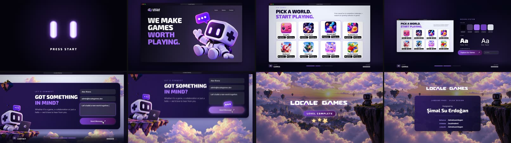

# locale-games

A 24 s, 1920×1080, 60 fps showcase of the **Locale Games** landing page, made for X / Twitter and a UI/UX portfolio. Design by **Şimal Su Erdoğan** (Behance `/simalsuerdogan` · Dribbble `/susimalerd` · LinkedIn `/simalsuerdogan`).



The page is rebuilt in code at 1440 px wide inside a browser window, and the camera moves over it. The idea comes from the page's own line, *"Pick a world. Start playing."*: the page is played like a game.

| Bar (2 s) | What happens |
|---|---|
| 0 | Two glowing eyes in the dark, PRESS START, a click |
| 1–2 | The eyes become the hero robot's eyes; the camera pulls back; headline, button, hover, click. The HUD appears: level, progress, score |
| 3–4 | LEVEL 02 · GAMES: eight cards land on eighth notes (+100 each), a hover |
| 5 | Design system: the window steps back; colours sampled from the design, type, components |
| 6–7 | Through the clouds to the contact form: it fills, Send, the speech bubble flies off |
| 8 | The sunset footer, the logo, LEVEL COMPLETE and three stars |
| 9–11 | Designer credits, then a fade to black that loops back to the first frame |

```bash
node ft.mjs preview examples/locale-games
python examples/locale-games/sound.py      # 120 BPM score, about -14 LUFS
node ft.mjs render examples/locale-games
```

## Files

- `scene.js`: copy in `COPY` at the top, palette, the page sections (`hero`, `games`, `contact`), the camera (`camera()`, `scrollAt()`), HUD, cursor, footer and credits. Every time is `at(bar, step)`.
- `sound.py`: the same timeline in `ftsynth`: a coin per card, a chime per level, typing, the drop on bar 8.
- `assets/`: the design's images. `robot-hero.png` is cropped tight; if you replace it, re-measure its eyes and update `ROBOT` / `EYE` in `scene.js` so the hook's eyes still land on them.
- Fonts: Exo 2 (display, the closest match found for the design's headline face) and Inter.

## Notes

- The form's name and message (`Alex Rivera`, "Let's build a new world together.") are sample input.
- App Store / Google Play badges are drawn as plain labels; no third-party logos are recreated.

## Asset rights

The images in `assets/` (robot, icons, logo, sky, clouds, rocks) are the work of Şimal Su Erdoğan for Locale Games and are **not** covered by this repository's MIT license. They are included so the example runs; don't reuse them in other work without permission. The code (`scene.js`, `sound.py`, `project.json`) is MIT like the rest of the repository.
